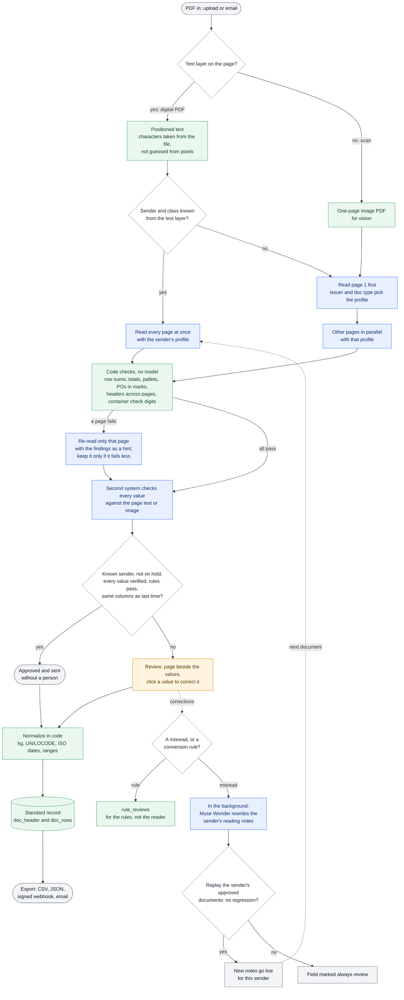

# Fobby Connect

**Connects every sender's freight document layout to one schema, and learns each sender so the next document needs less review.**

Freight forwarders retype every Shipping Order (SO) and Packing List (PL) by hand: 30–60 minutes per document, and every sender uses its own layout. Fobby Connect reads them with Meta's Muse Spark into one fixed schema, checks the numbers with code and every value with a second system, and learns each sender's layout from the clerk's corrections with Muse Wonder, so the next document from that sender needs less review, or none: a known sender's document that passes every check is approved and sent on without a person.

Live demo: https://connect.fobby.io. The screen is in English; it reads Chinese and English documents. No PDF of your own? Upload these synthetic ones (invented companies), in this order:

1. [Packing list 1](eval/samples/pl-1.pdf), 2 pages, from a new sender: it goes to review. Check it against the PDF and approve.
2. [Packing list 2](eval/samples/pl-2.pdf), same sender and layout: every value is checked, and it is approved without review.
3. [Shipping order](eval/samples/so-1.pdf), in Chinese, from another sender.

## How the reading pipeline is optimized

OCR alone gives text, not a shipment. The pipeline below turns a PDF into checked, typed values, and it puts the model only where code cannot do the job. Each stage either saves a model call, saves waiting, or catches an error before a person has to.



Blue steps call a model, green steps are code only, and the orange step needs a person.

| What we changed | Why it matters |
|---|---|
| **Route each page.** Digital pages go to the model as positioned text, and only scanned pages are sent as an image. | On a digital PDF every character comes from the file itself, so a 0 cannot turn into an O and a 1 into an l. Vision is used only for scans, where there is no text to take. |
| **Pick the reading profile early.** When the text layer already names the sender and says "packing list" or "shipping order", every page is read at once with that sender's profile. Otherwise page 1 goes first and its issuer picks the profile. | Multi-page documents from known senders do not wait on page 1. |
| **Prompt hierarchy.** The fallback prompt sits under a document-class profile, which sits under a sender profile. The sender profile holds notes and examples from that sender's approved documents. | A new sender still reads well, and a known one reads like the documents a person already approved. |
| **Strict schema, copy only.** The model returns JSON in a fixed schema, copies values as printed, and gives each value a box on the page. | No invented values. Every value can be shown on the page, and the code does all conversions. |
| **Checks in code, targeted re-reads.** Sums, pallets, POs and cross-page headers are checked without a model. Only a failing page is read again, with the findings as a hint, and the re-read is kept only if it fails fewer checks. | A wrong number that breaks a sum or a check digit is caught without a model call. A re-read costs one page, not a whole document. |
| **A second system on every value.** For a sender seen before, a separate decision model checks each value against the page. | A document is approved without a person only when two systems agree and every rule passes. |
| **Normalize once, store one record.** Kilograms, UN/LOCODE ports, ISO dates and package ranges are computed in code and stored one column per field. The raw text is kept beside each value. | Exports, webhooks and email all send the same checked values, whatever layout the sender used. |
| **Learn from the right corrections.** A correction that matches the printed text is a misread, and the sender's notes are rewritten from it. A correction that comes from a conversion goes to `rule_reviews` instead. New notes go live only if replaying the sender's approved documents shows no regression. | The reader learns only from real misreads, and a sender's reading never gets worse. |
| **Nobody waits.** An upload is listed as "reading" at once and the list updates when it is done. Learning runs after the approval, in the background. | The clerk keeps working while pages are read and while the reader learns. |

## How it works

1. **Receive.** Upload a PDF on the screen, or email it to the team's intake address: each attached PDF is read like an upload, and the document shows who sent it.
2. **Read.** Each page goes to `muse-spark-1.3` with a strict JSON schema: digital pages as positioned text, scanned pages as a one-page PDF. The model only copies what is printed, with a box per value.
3. **Check (code, no model).** Row sums against the totals line, pallets, PO numbers in the shipping marks, headers that differ between pages, container check digits. A page with failed checks is read once more with the findings as a hint.
4. **Second check.** For a sender seen before, a second system (Jev, a decision model) checks every value against the page: the printed text for digital pages, the page image for scans. A sender's first document skips it, because a person reviews every value anyway.
5. **Approve.** A document is approved without a person only when the sender is known and not on hold, every value passed the second check, every rule passed and the columns match the sender's last approved document. Anything else goes to review with the reasons. "This one is wrong" on an approved document sends it back and puts the sender on hold until a document passes review unchanged.
6. **Normalize (code, no model).** Printed text becomes typed values (dates, ports as UN/LOCODE, weights in kg, ranges, PO and part numbers filled down), and every value keeps its raw text.
7. **Review.** The clerk sees the page next to the result, wires printed columns to standard fields, adds a column the read missed (one page re-read, only the new column merged), edits raw text and sees the checks re-run.
8. **Learn.** On approval, `muse-wonder-1.0` compares the corrections with the printed text and rewrites that sender's reading notes, with no document-specific values. The new notes are activated only if replaying the sender's approved documents shows no regression; otherwise the field is marked "always review".
9. **Export.** One flow for the team: approved data branches by sender into its outputs.
   - Download: `GET /api/documents/<id>/export.json` (the full record: header, containers, line items and totals with raw text, the check results, a link to the PDF, how much was corrected; `schema_version: 1`) and `export.csv` (one line item per row for Excel; UTF-8 with BOM). Unapproved documents answer 409.
   - Webhook: the same JSON is POSTed as `document.approved` (or `document.corrected`), signed with `X-Fobby-Signature: sha256=HMAC(secret, timestamp.body)`. The receiver's status code and receipt id are kept; a failed delivery is retried after 1, 5 and 30 minutes and 2 hours with the same delivery id.
   - Email: the record goes out with the JSON and CSV attached, where the host provides a way to send mail.

## Run it yourself

Needs Node 22 and a Meta Model API key. The second check needs an OpenRouter key (`OPENROUTER_API_KEY`); without it every document goes to review.

```bash
npx -y pnpm@12.16.1 install --frozen-lockfile
cp .dev.vars.example .dev.vars   # then fill in META_API_KEY
npx -y pnpm@12.16.1 build:web
npx tsx src/server/local.ts      # http://localhost:8787
```

Data is kept in Postgres: documents, each document's standard record (`doc_header` and `doc_rows`: one column per field, in kg and UN/LOCODE whatever the sender printed, written after the read and replaced at approval with the values a person confirmed; exports read it), corrections that point at a conversion rule rather than a misread (`rule_reviews`), learning still to run after an approval (`learn_jobs`: it runs in the background and `retry()`, every minute, takes over one that was cut off), reading versions, approved examples, senders on hold, the export flow, deliveries waiting for a retry, the daily limit and every model call. Files under `DATA_DIR` (R2 on a host) hold only documents: each PDF, its read result and the request sent for each read. Without `DATABASE_URL` in `.dev.vars` the server runs an embedded Postgres (PGlite) in `data/pg`; with it (a direct connection URL) it uses that database. Either way the schema is applied on start; for another host, `npx tsx scripts/migrate.ts` applies it. Data kept as JSON files by an earlier version moves in with `npx tsx scripts/migrate-storage.ts` (add `--apply` to write; safe to run again).

Tests: `npx tsc --noEmit && npx vitest run`. Sample PDFs: `npx tsx scripts/build-samples.ts`.

## Meta models used

| Model | Where |
|---|---|
| `muse-spark-1.3` (standard tier) | Reading every page (`src/gateway/`), re-reads with check hints and missing columns, replaying approved documents to validate new notes (`src/pipeline/run.ts`) |
| `muse-wonder-1.0` | Comparing a clerk's corrections with the printed page and rewriting that sender's reading notes (`src/profiles/rewrite.ts`) |

Customer documents only go to tiers whose data is not used to train Meta's models; the gateway refuses to send anything but synthetic data to a contributor-tier model. The second check (`src/verify/`) is not a Meta model: it is Jev (TypeSafe) through OpenRouter's decisions API, and it is optional.

## Built during the hackathon

Everything in this repository was written between 2026-10-27 and 2026-11-04 (see the git history). Nothing from fobby.io, the author's freight-quote product, is used. Meta Global AI Developer Hackathon, Startups track, "Build for Your World".

| Part | Code |
|---|---|
| Meta Model API client, strict JSON schema output, retries, cost ledger | `src/gateway/` |
| Page routing (text or vision) and reading loop: read, check, re-read with hints, read a missing column | `src/pipeline/` |
| Prompt hierarchy (fallback, document class, sender) and learning from corrections with replay validation | `src/profiles/` |
| Normalization to typed values with raw text kept | `src/normalize/`, `src/transforms/`, `src/reference/` |
| Checks across rows, totals, pages and containers | `src/rules/` |
| Second check of every value against the page text or the page image, and automatic approval | `src/verify/`, `src/server/app.ts` |
| Review API for any JS host (Node server included); export flow with signed webhooks, retries and email; email intake | `src/server/` |
| Postgres storage (Drizzle): documents, reading versions, approved examples, daily limit and model calls; schema and move from JSON files | `src/server/db.ts`, `drizzle/`, `scripts/` |
| Review screen (React, shadcn/ui, pdf.js) | `web/` |
| Synthetic document generator, evaluation and samples | `eval/`, `scripts/` |

Sample and test documents are synthetic: invented companies, numbers and products.

## Licence

AGPL-3.0. The hosted version at connect.fobby.io runs this code.
